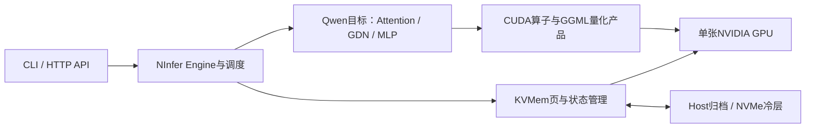

# NInfer Ada：单卡原生推理与 KVMem 长上下文


**v1.0.0 · 2026-10-21**

面向 NVIDIA Ada 单卡的 C++20/CUDA 推理项目。主要验证设备为 **RTX 4070 Ti SUPER，SM89 / 66 SM / 16 GiB**；当前主要模型是已有的 **Qwen3.8-27B GSQ-RCO-IQ3_S `.ninfer` v3**。项目提供命令行、HTTP 服务、MTP 投机解码，以及在有限 GPU KV 工作集上运行更长逻辑上下文的 KVMem 路径。

维护范围（2026-10-21）：后续主线只维护 **Qwen3.8-27B**。Qwen3.6-27B Groupwise/NVFP4 已退役，不再注册运行入口，本地权重删除；旧报告保留历史结果。`qwen3_6` 源码目录仍包含 Qwen3.8 共用实现。


本仓库也保留三元 Bonsai 和其它模型目标的实现。本页的质量、配置与性能结论以表中实际模型和工作负载为准。

> 提供两种显式配置：**短档 K7，32K 长档 K15**。本次长档原 213K 六请求 **6/6 精确正确**；18 次整体 Graph 测量通过，每档九次运行的完整 129 个输出 token 一致。详见[发布报告](docs/releases/v1.0.0.md)。

## 这套实现怎样运行



- **原生 Engine**：模型绑定、聊天模板、调度、KV 页、GDN 状态、投机接受与提交由 NInfer 管理，产品入口直接调用 C++/CUDA。
- **GGUF 编码仍可原生运行**：当前 GSQ artifact 保留 IQ3_S、IQ3_XXS、IQ4_XS、Q4_K 等逐张量量化块，并通过本仓 GGML CUDA bridge 计算。混合量化描述权重表示；推理由 NInfer 执行，不启动外部 llama.cpp 进程。
- **`.ninfer` 是模型契约**：容器还携带目标配置、张量布局、语义绑定、tokenizer/模板，以及相应 MTP、Vision 等组件。把任意 `.gguf` 改后缀不能得到可执行模型；转换必须匹配已实现的模型目标及其真实组件。
- **GPU 工作集与逻辑上下文分开**：KVMem 按查询和历史证据选择页，使用受限 GPU 池，其余历史由 Host/Cold 归档。它不是让所有历史 KV 同时常驻 GPU。
- **完整混合状态恢复**：不可变 K 来源保留已表示的量化 K 码、尺度及 birth positions；页恢复同时受 owner/generation、pin 与 CUDA 完成事件约束。选页变化后，canonical 路径重建所选有序历史对应的 GDN 与各层 KV，再回放问题。

后一点影响 TTFT：逻辑 prompt 已命中公开 prefix cache，仍可能需要内部历史重建。项目分别记录 logical computed/cached、history/query replay、source restore 和搬运指标，不把“缓存命中”视为“完全没有重算”。

## 运行环境与模型

| 项目 | 本项目当前明确范围 |
|---|---|
| 主要实测平台 | Linux、RTX 4070 Ti SUPER 16 GiB，CUDA 13.4；单 GPU、C1 |
| 编译工具 | CMake ≥ 3.28、Ninja、支持 C++20 的 CUDA 兼容宿主编译器；本次使用 CUDA 13.4 |
| Linux 系统依赖 | pkg-config、FFmpeg 开发库：libavformat ≥ 60、libavcodec ≥ 60、libavutil ≥ 58、libswscale ≥ 7；媒体输入还需 libcurl ≥ 7.85 |
| 主要验收模型 | `qwen3_8_gsq_rco_iq3_s_v3.ninfer`，15,017,456,896 bytes |
| 其它编译目标 | CMake 提供 SM75、SM86、SM89、SM120a；本页性能不外推其它 GPU |

权重独立准备，遵循模型和量化来源的许可证。程序按启用组件 materialize 权重；MTP、DFlash2、Vision 的显存需求不同，16 GiB 文本配置不能直接复用为任意多模态/高并发配置。历史长档服务记录约18–20G主存峰值，另有GPU显存、pinned buffer和文件缓存开销。

模型组件、格式与已验收入口可查 [GSQ 原生验证](docs/maintainer/2026-10-20-v3-gsq-live-validation.md)。

本机日常GPU功耗上限现为 **200W**，通过系统服务开机自动应用。32K/MTP15：decode **197.57 tok/s**、prefill **1431.27 tok/s**；4K/MTP7：decode **172.55 tok/s**、prefill **1554.61 tok/s**。旧v1.0.0表保留原测量功耗，不能混作200W结果。[功耗对照、方法和撤销方式](docs/performance/2026-10-21-power-cap.md)。

固定213K长题从已保存的完整前缀恢复时，新增分块完整性索引：200W同binary三对的load用时中位24.32→10.77s、首TTFT47.42→34.16s，成对首TTFT减少27.6%、六题会话减少7.3%；213K36/36、256K6/6通过，已作为快照恢复默认。该范围是固定基准状态加载，cold-prefill和后续decode另计。[理论、完整对照与回退](docs/maintainer/2026-10-22-checkpoint-io-optimization.md)。

续问复用进一步减少重复重建：200W同binary原213K三对，六题会话中位 **145.23→36.11s**，后续单题TTFT中位 **22.06→0.404s**，历史回放 **185836→32228 tokens**；36/36及256K6/6精确正确。固定快照工具默认启用，普通Serve显式设 `NINFER_KVMEM_CANONICAL_QUERY_REUSE=1`；状态/证据/容量不满足时沿用原重建。这组ABI1对照的首请求仍约33.5s，R21原位置模式仍关闭。[资格、整体对照与回退](docs/maintainer/2026-10-22-canonical-query-reuse.md)。

完整canonical-ready快照继续省掉首次重建：200W同binary原213K三对，首TTFT中位 **32.99→10.35s**，六题会话 **35.54→13.11s**（成对减少68.62%/63.11%），history replay **32228→0**。36/36与256K重启6/6精确正确；后五题TTFT合计2.03→2.31s的小回退保留。固定快照工具现auto优先使用已有ABI2包；首次生成及索引创建另计，原ABI1包保留。[完整结果、生成与回退命令](docs/maintainer/2026-10-22-canonical-ready-checkpoint.md)。

快照加载再做有界流水：双槽H2D、Host直接读取与私有COW首次K区间，200W同binary原213K三对，load中位 **10.886→10.380s**、六题会话 **13.881→13.436s**（成对减少4.64%/3.47%）。36/36及额外raw213K、256K各6/6精确；后续TTFT无改善。固定工具213K默认采用，256K仅显式 `--checkpoint-load-pipeline`；该项不是逐层forward/P4通过。[实现、原值与参考命令](docs/maintainer/2026-10-22-checkpoint-load-pipeline.md)。

投机档位复核：MTP4在200W原213K/256K六题各自生成+独立恢复均6/6精确；额外256K六题会话同SSD三对中位快4.22%，但正式4K/32K tg128三对中，MTP4相对MTP15的decode分别慢14.00%/33.42%，因此维持默认MTP15。另修复显式adaptive MTP的cohort/lane epoch复位：200W新binary下4K/32K固定MTP4与adaptive MTP4各三对输出、usage均一致，session中位反而慢1.13%/0.29%，**仅保留opt-in**，DeepInfer host跨轮队列尚未采用。[S3正式对照](docs/maintainer/2026-10-22-s3-mtp4-long-quality.md) · [S5控制器与host/device实测](docs/maintainer/2026-10-22-s5-deepinfer-host-mtp.md)。

## 构建

在源码根目录执行。4070 Ti SUPER 必须显式选择 SM89；CMake 默认架构不是本机 Ada。

```sh
cmake -S . -B build -G Ninja \
  -DCMAKE_BUILD_TYPE=Release \
  -DCMAKE_CUDA_ARCHITECTURES=89 \
  -DNINFER_SM_COUNT=66 \
  -DNINFER_BUILD_APPS=ON \
  -DNINFER_BUILD_BENCHMARKS=ON

cmake --build build --target ninfer ninfer-serve ninfer_bench -j2
```

产物为 `build/apps/ninfer`、`build/apps/ninfer-serve` 和 `build/bench/ninfer_bench`。CUDA 编译较占主存，示例使用两个并行 worker。其它架构需要选择对应目标并重新构建。

## 从一次文本请求开始

```sh
export NINFER_MODEL=/absolute/path/qwen3_8_gsq_rco_iq3_s_v3.ninfer

# 本页短请求配置B；这些开关需在进程启动前固定。
export NINFER_GGUF_MMQ_BF16=1 NINFER_GGUF_IQ2_S_MMQ_BF16=1
export NINFER_GGUF_IQ3_S_MMQ_I64=1 NINFER_GGUF_IQ3_XXS_MMQ_I64=1
export NINFER_PROMPT_I8_PIPELINE=1 NINFER_R27_BUNDLE=1
export NINFER_R26_BUNDLE=0 NINFER_R28_BUNDLE=0 NINFER_R29_BUNDLE=0

./build/apps/ninfer "$NINFER_MODEL" \
  --prompt '请用一句话介绍你自己。' \
  --max-context 8192 --prefill-chunk 512 --max-new 64 \
  --kv-dtype int8 --spec mtp --draft-tokens 7 --lm-head-draft \
  --greedy --no-thinking
```

该入口显式选择MTP7和optimized proposal head；程序本身未指定 `--spec` 时仍关闭投机解码。固定MTP接受1–15个draft，Serve/API的adaptive或lookup模式上限仍为7；参数支持范围不等于任意工作负载的性能或质量保证。

HTTP 服务：

```sh
./build/apps/ninfer-serve "$NINFER_MODEL" \
  --host 127.0.0.1 --port 8080 --model-id qwen3.8-27b \
  --max-context 8192 --kv-capacity 8192 --prefill-chunk 512 \
  --max-concurrency 1 --kv-dtype int8 \
  --spec mtp --draft-tokens 7 --lm-head-draft \
  --greedy --no-thinking
```

```sh
curl -sS http://127.0.0.1:8080/health

curl -sS http://127.0.0.1:8080/v1/chat/completions \
  -H 'Content-Type: application/json' \
  -d '{"model":"qwen3.8-27b","messages":[{"role":"user","content":"Reply exactly with hello."}],"max_tokens":32,"temperature":0}'
```

服务还提供 `/v1/responses`、`/v1/messages`、模型查询与 token 计数接口；`/metrics`、`/slots` 和 `--request-log-jsonl` 用于观察实际请求与容量。CLI 参数见 [CLI 文档](docs/cli.md)，具体可用参数以当前二进制 `--help` 为准。

## 长上下文：有界GPU工作集与显式K15配置

本次长档吞吐实测是32,768-token prefill、128-token decode、逻辑ctx36,864的resident工作负载。更长逻辑上下文通过KVMem运行：以下配置保持32K工作集和36K物理KV池，逻辑context设为212,992。它的K15原六题质量状态为 **`2026-10-21：最终 K15/Graph/sync 长档配置的原 213K 六请求 **6/6 精确正确**，HTTP、流终态和 usage 完整，server 正常退出。`**，通过后才作为发布长档使用；既有K7原题6/6记录另列于质量表。

| 参数 | 长配置值与含义 |
|---|---|
| 逻辑context | 212,992；冻结原题实际prompt为212,276–212,441 tokens |
| GPU物理KV池 | 36,864 tokens |
| KVMem工作集 | 32,768 tokens，generation reserve512 |
| KV / prefill | INT8、chunk512 |
| 并发与解码 | C1、固定MTP15、optimized proposal head、CUDA Graph |
| 搬运模式 | sync |
| global Host KV | `--host-kv-mib 0`；独立KVMem归档、StateImage和pinned staging仍存在 |
| 恢复路径 | canonical；original-position实验路径保持关闭 |

<details>
<summary>已通过原213K六题的长档K15启动命令</summary>

```sh
mkdir -p .cache/kvmem

env \
  NINFER_R27_BUNDLE=1 NINFER_R26_BUNDLE=0 NINFER_R28_BUNDLE=0 NINFER_R29_BUNDLE=1 \
  NINFER_PROMPT_I8_PIPELINE=1 \
  NINFER_GGUF_MMQ_BF16=1 NINFER_GGUF_IQ2_S_MMQ_BF16=1 \
  NINFER_GGUF_IQ3_S_MMQ_I64=1 NINFER_GGUF_IQ3_XXS_MMQ_I64=1 \
  NINFER_KVMEM_SOURCE_LAYER_BATCH=1 NINFER_KVMEM_SOURCE_COPY_BATCH=1 \
  NINFER_KVMEM_SOURCE_READ_AHEAD=1 \
  NINFER_KVMEM_ORIGINAL_POSITIONS=0 NINFER_KVMEM_VERIFY_ORIGINAL_STATE=0 \
  NINFER_KVMEM_COLD_DIR="$PWD/.cache/kvmem" \
  ./build/apps/ninfer-serve "$NINFER_MODEL" \
    --host 127.0.0.1 --port 8080 --model-id qwen3.8-27b \
    --max-context 212992 --kv-device-tokens 36864 --prefill-chunk 512 \
    --host-kv-mib 0 --max-concurrency 1 --kv-dtype int8 \
    --kvmem --kvmem-budget 32768 --kvmem-gen-reserve 512 \
    --kvmem-action-lrfu --kvmem-lrfu-lambda 0.5 --kvmem-lrfu-top-frac 0.3 \
    --kvmem-transfer-mode sync \
    --spec mtp --draft-tokens 15 --lm-head-draft --greedy --no-thinking
```

Cold目录设在NVMe挂载点时使用该设备上的文件后备；目录和file capacity指标不代表每次读取都穿透物理SSD。source read-ahead使用两个有界pinned slot，默认0、示例显式启用；它和普通页搬运async分别配置。该命令不提供断电后跨进程恢复会话保证。

</details>

### Async Page Pipeline 的当前状态

已实现页事务与解码计算重叠、有界批次拆分、ready/completion事件、pin与owner/generation检查、失败排空和回退。通过 `--kvmem-transfer-mode async` 显式选择；默认仍为 **sync**。

2026-10-20的P4成对测试包含18会话/54请求，全部正确完整；深轮async相对同对sync的session wall缩短中位约 **0.54%**，未达到预设10%的默认采用门槛。它证明当时配置的功能与有界生命周期，不支持“超池完全不减速”或“async已带来10%加速”。后续MMQ/MTP/source改动也没有自动更新这份P4结论。详见 [活跃验证记录](docs/maintainer/2026-10-20-kvmem-actkv-live-validation.md)。

## 质量与支持范围

| 日期 | 模型与工作负载 | 已有结果 | 范围 |
|---|---|---|---|
| 2026-10-21 | Qwen3.8 GSQ、32K工作集、原213K六请求、MTP7/Graph/sync、近期三格式decode profile | **6/6精确正确**，HTTP/terminal/usage完整，server正常退出 | 原冻结事实题及该显式单卡配置；不是任意213K任务的准确率基准 |
| 2026-10-22 | Qwen3.8 GSQ、32K工作集/36K物理KV、原213K和256K、**MTP4/Graph/sync**、200W | 两档分别首次保存与独立新进程恢复均**6/6精确正确**，原模型、原输入和对应ABI1包身份匹配 | [MTP4冻结长题收据](docs/maintainer/2026-10-22-s3-mtp4-long-quality.md)；尚不代表当前MTP15已重新验证256K，也不能跨draft-width使用snapshot |
| 2026-10-20 | Qwen3.8 GSQ、32K工作集、原256K六请求；sync与async各一臂 | **12/12正确完整**，实际261,411–261,576 prompt tokens，两臂输出/usage一致、终态在飞0 | 较早功能版本，base/no-Graph，无MTP/DFlash2；没有在当前MTP7或MTP15配置重新认证256K |
| 2026-10-20 | 小工作集超池、保留分支及短Graph/MTP/DFlash2语义 | 对应固定fixture通过 | 不合并成任意后端/上下文/并发组合通用保证 |
| 2026-10-20 | 真实图像、双图、短MP4，及Vision+MTP / Vision+DFlash2部分组合 | 原生HTTP请求完成，部分受控图像描述与输入一致 | 小尺寸、短请求功能验收；未建立高分辨率、长视频或长上下文媒体准确率 |
| 2026-10-21 | 当前发布binary：T16/BF16输出、SiLU-down融合与K15 round/layout；两档整体Engine | **50次Op与K15单元通过；18次整体Graph运行通过，各工作负载9次完整129 IDs一致；短档Graph与既存Eager语义一致** | K15长档原六题 **6/6精确正确**，HTTP/终态/usage完整，server0；256K及媒体未以K15重新认证 |

较早213K失败及修复保留在 [状态重建记录](docs/maintainer/2026-10-20-213k-state-replay-repair.md)；较新的质量与未采用候选见 [活跃验证记录](docs/maintainer/2026-10-20-kvmem-actkv-live-validation.md)。[多图/视频记录](docs/maintainer/2026-10-20-v3-vision-multi-image-video-single-gpu.md) 与 [Vision+投机组合记录](docs/maintainer/2026-10-20-v3-combined-vision-spec-single-gpu.md) 单列媒体边界。

## 整体性能对照

以下为2026-10-21本机同一v1.0.0 binary的完整Engine测量。**A是本binary的显式回退配置：六个性能开关全0、MTP7；它不是旧版本或程序默认值。** B为六开关全1、MTP7；C在B上启用 `NINFER_R29_BUNDLE=1` 并选择MTP15。六开关是 `NINFER_GGUF_MMQ_BF16`、`NINFER_GGUF_IQ2_S_MMQ_BF16`、`NINFER_GGUF_IQ3_S_MMQ_I64`、`NINFER_GGUF_IQ3_XXS_MMQ_I64`、`NINFER_PROMPT_I8_PIPELINE`、`NINFER_R27_BUNDLE`；两档均保持R26/R28关闭。

共同条件：同一Qwen3.8 GSQ artifact、RTX4070 Ti SUPER、INT8/chunk512、C1、CUDA Graph、optimized proposal head；每次一个warmup和一个测量，顺序为 **ABC / CBA / ABC**。短、长各9次，共18次完整运行；每档9次生成的完整129 IDs相同。`pp`和`tg`分别按prefill token数与128个decode token归一化，不含加载和warmup。

| 整体工作负载 | 配置 | prefill tok/s | decode tok/s | 对A成对吞吐提升中位数：prefill / decode |
|---|---|---:|---:|---|
| pp4096 + tg128，ctx8192 | A：回退K7 | 1882.90 | 186.59 | 基线 |
| 同上 | **B：短档K7** | **1973.53** | **189.75** | **+5.23% / +0.76%** |
| 同上 | C：K15 | 1993.98 | 160.94 | +5.77% / −14.69% |
| pp32768 + tg128，ctx36864 | A：回退K7 | 1683.13 | 173.41 | 基线 |
| 同上 | B：K7 | 1831.00 | 175.03 | +9.16% / +1.56% |
| 同上 | **C：长档K15** | **1838.12** | **192.92** | **+9.58% / +11.78%** |

绝对tok/s由每配置的三次时间中位数计算；百分比为三个成对比值的中位数，因此不要求等于表中两个绝对中位数之比。短档B/A的prefill三对均正，decode两正一负；长档B/A和C/A的prefill/decode三对均正。C相对B在短档decode退化 **15.18%**，在长档decode提升 **10.22%**、三对均正，因此保留两个显式入口；本次比较没有建立通用自动切换阈值。

接受工作量也随输入变化：短档K7为17 rounds / 117 drafted / 111 accepted，K15为12 / 164 / 116；长档K7为17 / 113 / 111，K15为9 / 124 / 119。输出相同不代表两种profile执行了相同的草稿工作。

原始秒数、成对值、binary和环境身份见[整体性能数据](docs/releases/v1.0.0/overall-performance.json)与[发布报告](docs/releases/v1.0.0.md)。这是整模型profile比较，不能拆分认领每个开关的贡献。 本轮原213K单臂API TTFT：首题 152.59s，后五题中位 17.71s；仍重放185,836个历史tokens。原213K的TTFT还包含selected-history重建、页与状态恢复和调度；**本轮没有进行配对TTFT或新P4性能测量**，resident吞吐不能直接换算超池TTFT，也不支持设备最优结论。

本地整体入口示例（先采用上文B配置环境）：

```sh
./build/bench/ninfer_bench --weights "$NINFER_MODEL" \
  --max-ctx 8192 --prefill-chunk 512 --kv-dtype int8 \
  --spec mtp --draft-tokens 7 --lm-head-draft \
  -pg 4096,128 -r 1 --warmup 1 -o json --output-file bench-short.json

# C配置的32K预填工作负载
NINFER_R29_BUNDLE=1 ./build/bench/ninfer_bench --weights "$NINFER_MODEL" \
  --max-ctx 36864 --prefill-chunk 512 --kv-dtype int8 \
  --spec mtp --draft-tokens 15 --lm-head-draft \
  -pg 32768,128 -r 1 --warmup 1 -o json --output-file bench-long.json
```

## 文档与代码入口

| 入口 | 内容 |
|---|---|
| [Engine架构](docs/maintainer/engine-architecture.md) | 公共Engine、调度、目标与状态分工 |
| [KVMem容量解耦](docs/kvmem-capacity-decoupling.md) | 逻辑上下文、设备工作集和Host容量的不同含义 |
| [CLI](docs/cli.md) | 文本、消息、采样及媒体输入 |
| [GGUF dispatch](src/ops/linear/gguf/gguf_dispatch.cpp) | 向量/矩阵产品、activation量化、BF16输出边界 |
| [页与不可变K来源](src/kvmem/) | Cold store、source-K恢复、读前及生命周期 |
| [Qwen family runtime](src/targets/qwen3_6/impl/runtime/) | prefix、canonical重建、GDN状态与投机提交 |
| [v1.0.0发布报告](docs/releases/v1.0.0.md) | 本次发布范围、整体原值和二进制关联 |
| [发布质量数据](docs/releases/v1.0.0/quality-summary.json) | 原213K输出、TTFT样本与终态 |
| [数值资格](docs/releases/v1.0.0/numerical-validation.json) | 十格式、完整head、融合量化及各自参考边界 |

## 来源与许可证

本项目基于 [NInfer](https://github.com/Neroued/ninfer) 的C++/CUDA Engine及相关Ada/Ampere移植，保留 [NOTICE](NOTICE) 中各作者贡献。内核及执行参考包括 [UDPSendToFailed/ninfer-4090](https://github.com/UDPSendToFailed/ninfer-4090)、[sergiuszm/ninfer-4090](https://github.com/sergiuszm/ninfer-4090) 与ninfer-3090系列；量化产品复用仓库固定的 [GGML](https://github.com/ggml-org/llama.cpp) CUDA源码。

KVMem、恢复与异步实现优先参考 [KVMem](https://github.com/kvmem/kvmem)、[ActKV](https://github.com/melis2023/ninfer-kvmem-actkv)、[Strata](https://github.com/Niko1221/Strata)、[Ninfer-KVMem-Async](https://github.com/paicat1/Ninfer-KVMem-Async) 及相关转换项目的已有源码。具体移植保留来源说明，并适配本项目页布局、数值边界和owner/pin/event生命周期；不同项目的性能数据不作为本项目成绩。

仓库主许可证见 [Apache-2.0 LICENSE](LICENSE)。vendored GGML采用其 [MIT许可证](third_party/ggml-quants/LICENSE)，其余第三方与FFmpeg按各自许可和通知分发，见 [NOTICE](NOTICE) 与 [FFmpeg说明](LICENSE-FFMPEG.txt)。模型权重、tokenizer和量化来源另受各自许可证约束。
