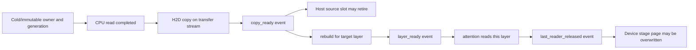

# OpenSpec S2：页恢复阶段测量与 layer-ready 消费依赖（2026-10-22）

本记录覆盖 `absorb-donor-techniques-and-optimize-sm89` 的 3.1、3.2 有界里程碑，并给 3.3–3.5 保留明确接口与验收边界。主机为单卡 RTX 4070 Ti SUPER / SM89，日常功耗上限 **200W**，模型为现役 Qwen3.8 GSQ v3，固定 213K 原题使用 **ABI1 raw** 快照。所有恢复字节与 K/V 数学保持原样；原位置 R21 (`2.1`/`2.4`–`2.7`) 尚未完成。

## 1. 真实阶段画像

在 `src/kvmem/kvmem_source_k.h` 的 source-K 页恢复入口布置仅供诊断、默认关闭的 CUDA event 与 Host 等待时间，在 `program_impl.h` 的 canonical 历史重建入口读取现有 `ExecutionTiming`。启动环境 `NINFER_KVMEM_STAGE_TRACE=1`；未启用时不创建计时 event、不插入等待，沿用既有 sync 数学/队列。

复用冻结完整 ABI1 raw + 原 213K 六题，`200W`、原有 sync profile、同一个新构建 binary、无重试。收据与原始日志：

- `tmp-nvcc/opsx-layer-stage-profile/quality-raw213k/{manifest.json,results.json,213k-stage-profile.log}`；机器可读摘要 [`docs/performance/2026-10-22-layer-ready-stage-profile.json`](../performance/2026-10-22-layer-ready-stage-profile.json)。
- 直接调用 `python3 -m tools.bench.kvmem_qualification run tmp-nvcc/opsx-layer-stage-profile/quality-raw213k`；重跑必须复制 manifest 到新的空目录并更新 binary 和请求日志路径，该 runner 会拒绝覆盖既有 `results.json`。本次显卡上限通过 `nvidia-smi` 只读确认已是 200W，未调用 sudo/更改功耗设置。
- 实际 **6/6 完整 terminal + 精确文本正确**，服务正常退出，末端 `ninfer:kvmem_inflight_pages=0`、`...bytes=0`。
- **版本边界：** 这次长题测量编译于 3.2 Cold generation guard 加入**之前**。新增 guard 仅在原题本次未走到的 async Cold 分支生效，后续 production binary 已重新编译、通过下述两组原生夹具；没有为了纯生命周期补丁重复六道长题。不能把这次六题称为最后一次构建的独立长题质量验收。

| 真实阶段 | 本次 213K raw 六请求测量 | 可解释的边界 |
|---|---:|---|
| source-K 还原页 / 有位置变化的页 | 522 / 494 | 两个 `ImmutableKStore` 合计；522 页均有独立 GPU event |
| source-K 文件读取 `future.get()` 的**暴露等待** | **127.751 ms** | 仅 CPU 等待，预读期间未暴露的文件 I/O 不在此值内 |
| source-K H2D GPU event | **18.951 ms** | 实际 DMA 时间之和，事件插桩可能带来额外开销 |
| source-K 位置重建 GPU event | **8.564 ms** | 只有需要 rerrope/rebuild 的页计入 |
| 普通 KVMem 搬运记录 `transfer_us` | **57.168 ms** | 258 次既有分段 DMA 调用，不能与 H2D event 当成独立开销直接相加 |
| Cold tier 读取 | **0 页** | 此固定 raw 恢复触发 source-K 及 Host/Device 路径，没有触发 Cold 文件读取；本行不能证明 Cold 很快 |
| 完整 canonical 历史 forward | **32,228 tokens，63 chunks，23,167.000 ms** | `ExecutionTiming` 主机侧 wall，包括设备等待；不是孤立 kernel 时间 |
| forward Host submit / Host device-wait | **13,341.757 / 9,825.205 ms** | 已包含在上一行的 23.167s 里 |

取该运行的 `future.get()` 暴露等待 127.751ms、已有搬运总计 57.168ms、source GPU rebuild 8.564ms 直接**相加**，得到故意偏乐观的 **193.483ms**。这些分项本身可能互相覆盖，不能把和视为真实串行开销或实际可实现加速。相对于旧 ABI1 raw 六请求约 35.538s 的会话尺度，它只相当于 **0.544%**；旧值来自另一次同配置无插桩运行，**不是本次成对性能对照**。此上限仅涵盖这三类**已测到的暴露工作**，并不能界定未测 CPU 工作、不同 Cold 压力或未来真正 layer-ready 路径的全部机会。

这一画像指出：冻结 raw 长题的主要可见成本是 **23.17s 的历史 forward**；在这个已测样本中，单独重排当前 source-K/Host 传输不能合理承诺 P4 会话改善 10%。应先接入消费者层的真实依赖与适用 Cold 场景，再决定是否运行昂贵的完整三对。

## 2. 已有槽位预算与可消费事件

`KVPageGeometry` 的实际 GSQ Main16/MTP1、INT8-G64、64-token PageMajor 下，每个主层 K-only 源页 **1,081,344 B**，MTP K-only **67,584 B**；完整 K+V 页分别 **2,162,688 B** 与 **135,168 B**。这些是读取元数据/几何计算出的物理字节，不是额外分配请求。

| 独立缓冲所有者 | Main16 固定上限 | MTP1 固定上限 | 合计上限 | 生命周期 |
|---|---:|---:|---:|---|
| 现有 source-K 双读槽（正常 read-ahead / event 路径） | 2 × 1,081,344 B | 2 × 67,584 B | **2,297,856 B** | 每个 CPU slot 在 `future.get` 后由 H2D 使用，copy-complete 之后才可填新来源 |
| 现有 Cold 三页 staging arena（其中最多两页并行 `prefetch`） | 3 × 2,162,688 B | 3 × 135,168 B | **6,893,568 B** | 第三页留给同步 spill/restore；H2D 读取完成前不释放 HostAllocation |
| **上述两类合计** | **8,650,752 B** | **540,672 B** | **9,191,424 B（约 8.77 MiB）** | 各 store 原有上限，不包含常规 Host KV cache、checkpoint 整包槽、CUDA graph/workspace 等常驻内存 |

`NINFER_R26_BUNDLE=1` 的旧分组 restore 使用 **4 个 source staging 页**（两个两页组），**不是**本次默认两个 source read slots；如启用需按 4 槽重新计入资源。不因 S2 诊断扩大 page pool / generation reserve，不申请无上限 Host futures，也不隐式开启 CPU copy workers。现役入口仍保持 `NINFER_KVMEM_SOURCE_EVENT_PIPELINE=0`、`NINFER_KVMEM_TRANSFER_PIPELINE=0`、sync 默认。

预期 **3.3** layer-ready 的消费者顺序为：

必须绑定 `(KVAddressSpace generation, logical block id, source slot+generation, physical destination, committed columns, original positions, state lineage/epoch)`。独立 Cold 文件读完成只允许提交 DMA；**H2D copy_ready 不等于该层 K 重建完成**，consumer 应在实际 `layer_ready` 上等待。**Host pinned source** 可以在最后 H2D reader 完成后释放，但如果**Device staging page**即将作为下一写入目标，copy stream 必须等上次的 `last_reader_released`（Strata 的 `kv_released→kv_copy→kv_ready→cs` 原因链）。不可在 GPU event 尚未记录时复用其编号给另一个目标，也不可把已入队 CUDA 操作或 future 视为已经完成。

注意**现有 source-K page restore 与普通 Host/Cold restore 都是整页、包含 16 层 planes**。`kvmem_rebuild_source_k` 的 batch kernel 可能同时重建所有层；`kvmem_compact` 在整批 restore/rephase 后发布 address page table，`schedule::prefill_text_chunk` 此后才真正遍历各层。尚不存在 `TextContext` 中逐层消费前等 `layer_ready` 的 hook，所以**3.3 和 Async P4 尚未实现**。直接删 `cudaStreamSynchronize` 会让部分 layer 看见旧页、破坏 staging 生命周期。下一步须先将层 plane group / producer 完成粒度对应到具体 `TextContext` attention 调用，处理 Graph 捕获和尾页，再由 last consumer event 释放物理写目标。

## 3. 本次 3.2 源代际与有界 Cold pending 补强

`src/targets/qwen3_6/impl/runtime/logical_kv_store.h` 已有的 `std::future` 双槽 Cold 预读，在需要 async device 的路径先提交最多两条独立读取；每条持有独立 `HostKVAllocation`，前一条经过 H2D 同步后才释放，再开始下条。此次补充：

1. `ColdRead` 随请求**值捕获** `ColdKVStore::Handle{slot,generation}`，`prefetch` 在源主线程绑定稳定 fd/offset；创建第三个 pending 时必须已有槽退休，明确拒绝 `size>=2`。
2. 在 `future.get()` 前与读完后分别检查记录 generation/owner 对应原请求、仍有效；不将被释放或替换的 I/O payload 拷给 GPU。
3. `ColdRead` 成员声明使异步 future 先于 HostAllocation 析构，异常展开时仍在 slot 缓冲释放前等文件操作结束。既有 CUDA H2D 在 source/buffer release 前完成同步，`PendingRestore/Demote` 持有设备租约直到原有完成事件退休。普通同步回退保留。

实际原生验证（`tests/kvmem_compact_test.cu`）复用独立 K/V CPU rephase oracle，不新建全模型矩阵：

| 测试 | 覆盖点 | 结果 |
|---|---|---|
| `--cold-prefetch` | 仅在已建立低 Host quota + Cold 文件归档后开启 async Cold 预读；对 #4/#5 两次归档召回做 V bitwise/K 误差校验，验证累计提交/完成至少两条 Cold futures 与最终退役 | **PASS，0 failure** |
| `--claim-prefetch` | 36-page physical pool、32-page address claim、Host quota 两页；多轮归档后强制同批重新需要旧 Cold lexical 页；要求本批 **≥2 Cold futures** 被先提交、最终全部退休，无在飞页、保留竞争 lane 资源及 generation reserve | **PASS，0 failure** |

原生 `--claim-prefetch` 的 K/V 在该容量 fixture 中以零初始化；它检查真实并行 pending 计数、资源归还与选择身份。**不能用它替代 `--cold-prefetch` 的非零 K/V 数值 oracle**。本次加强点是 source generation/Cold pending 这一级，**还没有跨 layer forward 的 GPU pin `released`**；Graph/尾页/取消全链路由 3.3/3.4 单独验收。

`--claim-prefetch` 本机日志 `tmp-nvcc/opsx-layer-stage-profile/native-claim-prefetch.log` 在 **3** 条 Cold futures 中记录 `submitted=completed=3`，CPU 暴露 Cold 等待 **144µs**、该小几何累积 `transfer_us=570µs`；另有 3 页 source-K 诊断 H2D event **0.028ms**、rebuild event **0.019ms**。这些是低容量原生夹具的数据，绝不按比例外推 213K 或 16-layer 长会话。非零 K/V 独立 oracle 的收据见 `native-cold-prefetch.log`。

## 4. 当前等待、回退和验收门

当前真实可重叠部分：Cold 最多两个 CPU I/O、source-K 两个 CPU read-ahead、部分既有 copy/rephase 的 CUDA 事件序。当前**仍需**等待的边界：每个 source-K 页 `restore_loaded()` 的 `cudaStreamSynchronize`、Cold 各页 H2D 之后的 `kvmem_cold_sync`、address table 发布之前的所有 rephase/restore 完成、Graph/forward 真实消费者尚未等 layer-ready。

错误及退出：CPU futures 必须先 join 后释放 staging；CUDA 出错需 drain 自己的 stream、pending destination/source pin，再报错。不能在 `catch` 后提前发布 address/table，也不能用异步 `submitted` 代替 `completed`。必要时留在原同步路径，不修改用户现役 profile；只有新 async 功能通过 213K 质量门、且独立 P4 200W **同 binary sync/async 三对 session wall 中位改善 ≥10%**，才有资格讨论改默认。256K 路径或 R21 首题错误均不能靠当前成功收据结项。

本轮构建包括 `ninfer-serve` 与 `ninfer_kvmem_compact_test`，200W 只读确认；本报告刻意不改变原数学、Graph、模型格式、快照 ABI、默认功耗或 sync 路由。`3.1` 与 `3.2` 完成；`3.3–3.6` 仍开。
